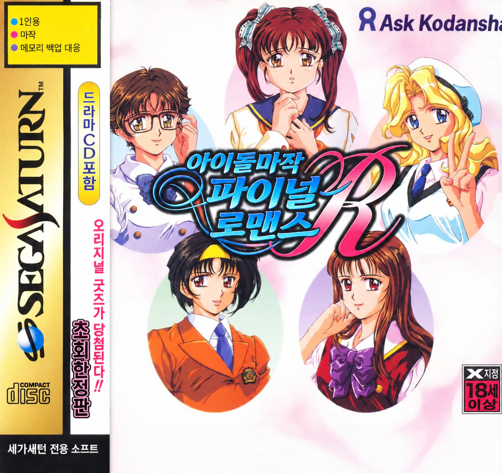
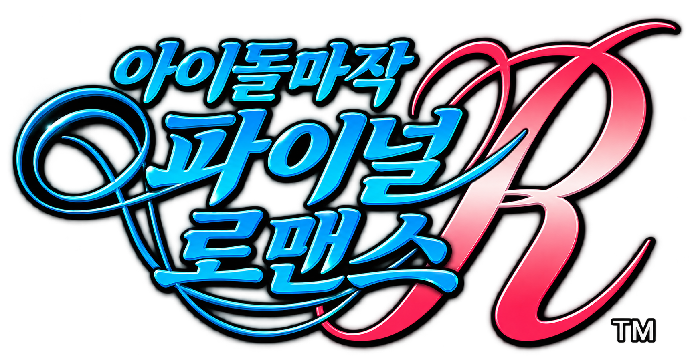

<p align="center"></p>

# 아이돌 마작 파이널 로맨스 R (Idol Mahjong Final Romance R) 세가새턴판 한글 패치

<p align="center"></p>

## 게임 소개

**아이돌 마작 파이널 로맨스 R**(アイドル麻雀ファイナルロマンスR)은 비디오시스템(VIDEO SYSTEM)·すぎやま現象이 1996년에 낸 세가새턴용 마작 게임입니다. 이 저장소가 다루는 것은 **세가새턴 일본판**(품번 T-16703G, V1.000)입니다.

- **장르**: 컴퓨터 상대와 1대1로 치는 2인 마작. 상점에서 아이템을 사서 대국에 쓸 수 있습니다.
- **상대**: 5명. 대국 전후의 이야기와 벌칙 연출은 **글자 창 없이 음성이 나오는 동영상**(Cinepak, 26편, 약 7분)으로 진행됩니다. 그래서 한글판에서는 동영상 위에 한국어 자막을 새로 얹습니다.
- **메뉴**: 타이틀 메뉴와 옵션 화면은 원판도 영어입니다(결정 D-2로 그대로 둠).

## 이 저장소

이 게임의 한글화 도구와 번역 데이터를 두는 곳입니다. **원본 디스크 이미지는 들어 있지 않고, 앞으로도 커밋하지 않습니다.** 사용자가 가진 원본 디스크 이미지에서 한글판 이미지를 만들어 내는 방식으로 배포할 예정입니다.

지원 대상 원본 (Redump식 BIN/CUE, 16트랙):

| 트랙 | 내용 | SHA-1 |
|---|---|---|
| 1 | 데이터 (MODE1/2352, 63,578섹터) | `2d12e26747034b4385e0b61164c2e715cc403cd1` |
| 2–16 | 오디오 | 2번 `bec1bf12a06d75dc38adcccea34d820a49831ae1` (나머지는 빌드 도구에서 검사 예정) |

## 현재 상태

**동영상 대사 번역 검수 단계** (2026-10-14). 원본에서 시험용 디스크 이미지를 만드는 빌드 도구가 있고, 한국어 자막 시험 디스크도 만들 수 있습니다(배포용 아님).

| 대상 | 내용 | 상태 |
|---|---|---|
| 동영상 음성 대사 | 26편 중 대사 64줄(5명), 감탄사만 있는 오프닝 5편은 자막 없음(D-4) | **한국어 번역 2차 검수 완료**(64줄 `reviewed`), 용어 승인 완료(D-9). 케이트 4줄·ry.013 청취 확인이 남음 |
| 동영상 자막 표시 | `1ST.BIN` 끝에 붙인 상주 코드(708바이트)가 동영상 묶음 시작 전에 그 묶음이 재생할 캐릭터의 자막 묶음(`ZSUB0–4.DAT`)만 VDP1 VRAM으로 읽고, 재생 중 매 프레임 재생 시각(1/600초)에 맞는 줄을 VDP1 스프라이트로 얹음 | **시험 디스크로 26편 64줄 모두 확인**(짧은 줄 포함, [한국어 예](docs/testdisc-ko-ri01.png)). 동영상 뒤 상점·대국·엔딩·앨범·프로필 화면 정상. 세이브 스테이트를 고쳐 재생한 결과이며, 실제로 이겨서 들어간 경로와 실기는 미확인. 묶음 시작 대기는 원본보다 약 0.29초 김(D-12로 0.69초에서 줄임) |
| 타이틀 로고 | 제공 그림 `title_ko.png`로 교체(D-3) | 로고 그림의 저장 위치 조사 전 |
| 상점·대국·프로필·옷 갈아입히기·엔딩 화면 | 화면 글자는 모두 그림(폰트 엔진 없음), 압축 없음. 목록은 [`docs/initial-survey.md`](docs/initial-survey.md) §3 | **글자 목록 조사 완료**. 상점의 일본어 글자(품목 이름 5개, 품목 설명 7장, 환영·작별 안내, 「시작」 단추, 산 품목 ↔ 표시)는 모두 한국어 그림으로 바꾸는 시험 성공([메뉴](docs/testdisc-ko-shop.png)·[설명](docs/testdisc-ko-shop-desc.png)·[안내](docs/testdisc-ko-shop-msg.png), 번역 제안 상태). 대국 화료(ロン/ツモ)·역 이름·점수 화면은 아직 못 봄 |
| 이어하기·앨범 틀·타이틀 메뉴·옵션 | 영어만 있음 | 바꿀 것 없음 |

조사 내용은 [`docs/initial-survey.md`](docs/initial-survey.md), 프로젝트 소유자 결정은 [`docs/decisions.md`](docs/decisions.md)에 있습니다.

## 번역 데이터

| 파일 | 내용 |
|---|---|
| [`translation/voice/ri.json`](translation/voice/ri.json) | 리나 동영상 대사 17줄 |
| [`translation/voice/mi.json`](translation/voice/mi.json) | 미카 동영상 대사 11줄 |
| [`translation/voice/ke.json`](translation/voice/ke.json) | 케이트 동영상 대사 10줄 |
| [`translation/voice/ry.json`](translation/voice/ry.json) | 료코 동영상 대사 14줄 (RY05 3줄 화자는 추정) |
| [`translation/voice/as.json`](translation/voice/as.json) | 아스카 동영상 대사 12줄 |
| [`translation/graphics/shop_menu.json`](translation/graphics/shop_menu.json) | 상점 품목 이름 5개 (제안) |
| [`translation/graphics/shop_desc.json`](translation/graphics/shop_desc.json) | 상점 품목 설명 7장 × 3줄 (제안) |
| [`translation/graphics/shop_msg.json`](translation/graphics/shop_msg.json) | 상점 환영 3줄·작별 2줄 (제안) |

각 줄에는 동영상 이름, 시작·끝 시각(초), 화자, 일본어 원문(`ja`), 한국어(`ko`), 상태(`reviewed` 등)가 있습니다. 2차 검수로 바뀐 줄에는 바뀌기 전 초벌(`ko_draft`)과 결정 근거(`ko_decision`)가 남아 있습니다. 받아쓰기는 faster-whisper large-v3(인식 힌트 있음/없음)와 kotoba-whisper v2.0 세 벌을 대조해 정했습니다. 모델끼리 갈려 확정하지 못한 줄에는 `flags: ["asr_uncertain"]`과 후보를 적은 `note`가 붙어 있습니다(케이트 4줄).

이름·말투·용어 결정은 [`translation/glossary.json`](translation/glossary.json)에, 2차 검수 결과는 [`translation/review/`](translation/review/)에 있습니다. 등장인물: 고이즈미 리나, 후지사키 미카, 케이트, 료코, 센도 아스카(D-5).

## 도구

| 경로 | 용도 |
|---|---|
| [`tools/asr/`](tools/asr/) | 동영상 음성 받아쓰기(`asr.py`: 파일 전체, `asr_slice.py`: 구간 재인식). faster-whisper와 CUDA가 필요하며 `work/audio16/*.wav`(동영상에서 뽑은 16kHz 음성)를 읽습니다. |
| [`tools/khpatch.py`](tools/khpatch.py) | 빌드: `python3 tools/khpatch.py build --source <원본.cue> --out <폴더> --subtitles ja\|ko\|none`. 원본 1번 트랙 SHA-1을 확인하고, 바뀐 섹터만 EDC/ECC를 다시 계산해 쓰기 계획으로 적용·감사합니다. 2–16번 트랙은 하드 링크(안 되면 복사)합니다. `--subtitles ja`는 일본어 원문을 띄우는 시험판이고, `none`은 원본과 바이트 단위로 같은 이미지를 만듭니다. |
| [`tools/fromance/`](tools/fromance/) | 빌드 모듈: 원본 검사(`disc.py`), ISO9660 루트 디렉터리 읽기·다시 짜기(`iso9660.py`), Mode 1 섹터 EDC/ECC(`cdsector.py`), 쓰기 계획(`writeplan.py`), 자막 그림·묶음·`1ST.BIN` 연결(`subtitles.py`) |
| [`tools/fromance/shopmenu.py`](tools/fromance/shopmenu.py), [`shopdesc.py`](tools/fromance/shopdesc.py), [`shopmsg.py`](tools/fromance/shopmsg.py), [`shopmark.py`](tools/fromance/shopmark.py) | 상점 품목 이름·설명·안내·단추·산 품목 표시 그림 교체(`--shop`, 시험용). 셀 `SHOPDAT.BIN`과 배치 표 `SL.BIN`, 설명 그림의 글자 상자를 같은 크기로 바꾸고, 빌드가 원본 대비 바뀐 바이트를 검사 |
| [`tools/subtitle/`](tools/subtitle/) | 상주 자막 코드(`crt.S`, `sub.c`, `sub.ld`). `docker run --rm -u "$(id -u):$(id -g)" -v "$PWD:/w" -w /w khsub sh tools/subtitle/build.sh`로 `assets/subtitle/SUB.BIN`을 만듭니다(SH-4용 gcc 13 이상, SH-2에 없는 명령 검사). |
| [`tools/poc/`](tools/poc/) | 동영상 자막 PoC. 연결 코드(`crt.S`, `poc.c`)를 SH-4용 gcc 14로 빌드하고 SH-2에 없는 명령이 없는지 검사(`build.sh`, `check_sh2.py`), 시험 자막 그림을 만들어 Mednafen 세이브 스테이트에 넣습니다(`mkpoc.py`). gcc 12.2는 SH 코드를 잘못 컴파일하므로 쓰지 않습니다. |

`work/`(원본에서 푼 파일, 음성, 세이브 스테이트, 에뮬레이터)는 저장소에 넣지 않습니다.

## 테스트

```sh
python3 -m pytest -q tests
```

- `test_voice.py`: 대사 파일과 용어 기록의 형식, 같은 동영상 안 시각 겹침, 동영상 26편이 빠짐없이 한 번씩 들어 있는지. `work/audio16/`가 있으면 말소리 구간이 모두 자막 줄이나 제외 항목에 들어가는지도 봅니다.
- `test_cdsector.py`, `test_iso9660.py`, `test_writeplan.py`, `test_disc.py`: 디스크 도구 단위 검사.
- `test_subtitles.py`: 자막 그림 크기·색, 묶음 형식(상주 코드와 같은 해석), `1ST.BIN` 리터럴 교체가 원래 값일 때만 일어나는지.
- `test_source_disc.py`, `test_build.py`: 원본(`orig/` 또는 `FROMANCE_SOURCE_CUE`)이 있을 때만 돕니다. 원본 왕복, 무변경 빌드가 원본과 같은지, 자막 빌드 결과를 디스크에서 다시 읽어 의도와 같은지.

## 남은 일

1. 프로필·엔딩 이름의 한자 읽기(특히 布川) 최종 확인.
2. 불확실한 5줄 청취 확인 후 대사를 배포 가능 상태로 올리기.
3. 대국 화료·역 이름·점수 화면 관찰, 그림 글자 목록(원본 위치·크기·팔레트) 작성과 한국어 그림 교체.
4. 타이틀 로고 그림 위치 조사와 `title_ko.png` 적용.
5. 제품 빌드 도구(원본 검사, 쓰기 계획, ISO·섹터 EDC/ECC, 배포 패치)와 실기 확인.

## 알림

이 저장소는 팬 번역 프로젝트이며 원저작권자와 관계가 없습니다. 게임의 저작권은 각 권리자에게 있습니다.
